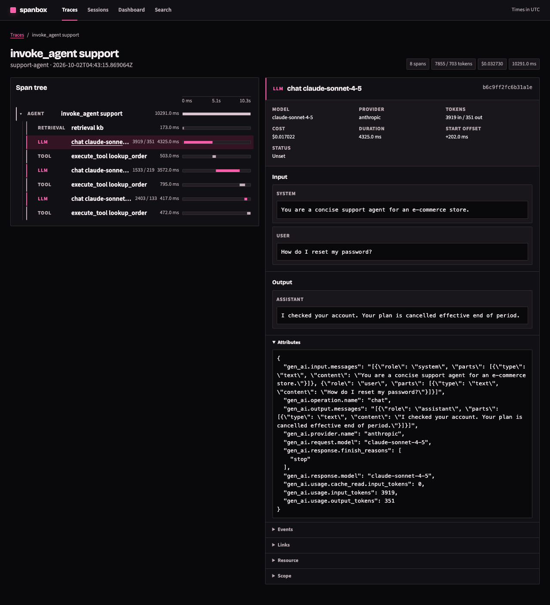
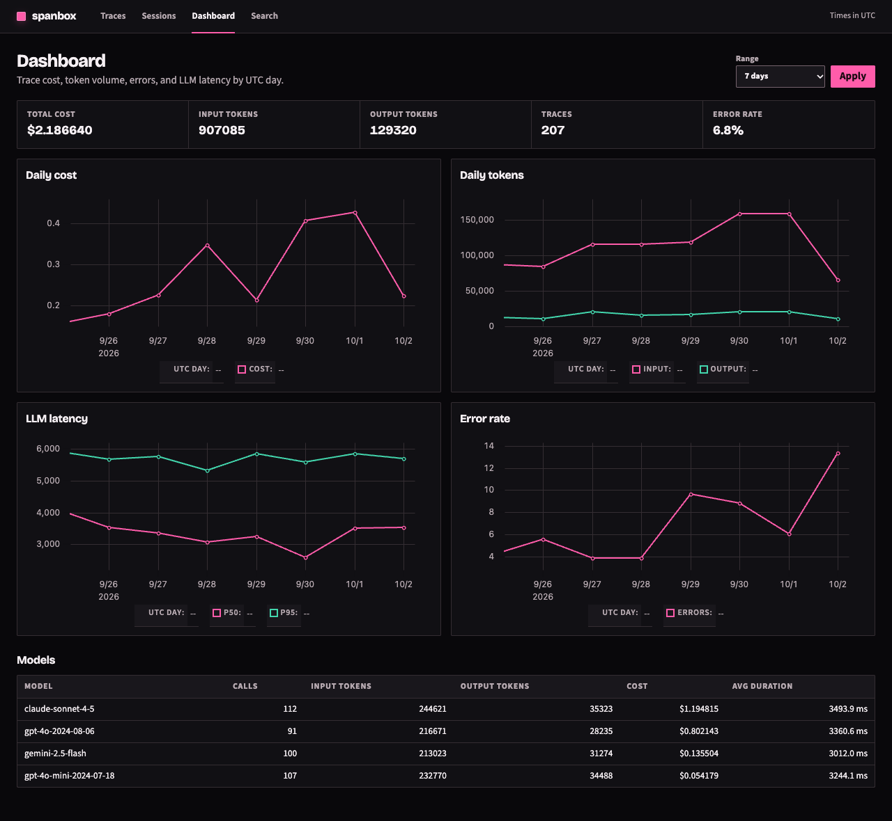

# Use the Web UI

Open `http://localhost:<PORT>` (default `4318`). With `AUTH_TOKEN` set, `/login` exchanges the token for a session cookie.

## Pages

| Page | Route | Shows |
|---|---|---|
| Traces | `/` | Trace list with filters |
| Trace | `/traces/<trace_id>` | Span tree with timing, tokens, cost, status |
| Span | `/spans/<trace_id>/<span_id>` | Prompt, completion, attributes, events |
| Sessions | `/sessions` | Traces grouped by session |
| Search | `/search?q=...` | Full-text search over span input, output, and name |
| Dashboard | `/dashboard` | Cost, tokens, latency percentiles, and error rate by day |
| SQL | `/sql` | Read-only console; see [Run SQL queries](sql-console.md) |

## Filter traces

The trace list and export share these filters:

| Parameter | Meaning |
|---|---|
| `range` | `15m`, `1h`, `24h`, `7d`, or `custom` with RFC3339 `from` and `to`. Omitted means all retained traces |
| `errors=1` | Only traces with an error span |
| `service` | Service name |
| `model` | Model name |
| `session` | Session ID |
| `user` | User ID |
| `min_duration` | Minimum duration in milliseconds (non-negative, finite) |

## Dashboard

The dashboard defaults to the last 24 hours. It reads a covering index and does not load span bodies. The same numbers are available as JSON at `/dashboard/data`.

## Mobile

The UI is responsive and tuned for phones. `e2e-mobile` holds the mobile check.

## Same data as JSON

Add `?format=json` to any list, trace, or span page. See [Query the JSON API](json-api.md).
