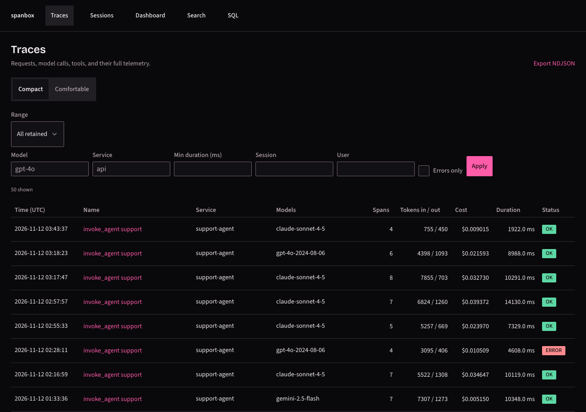
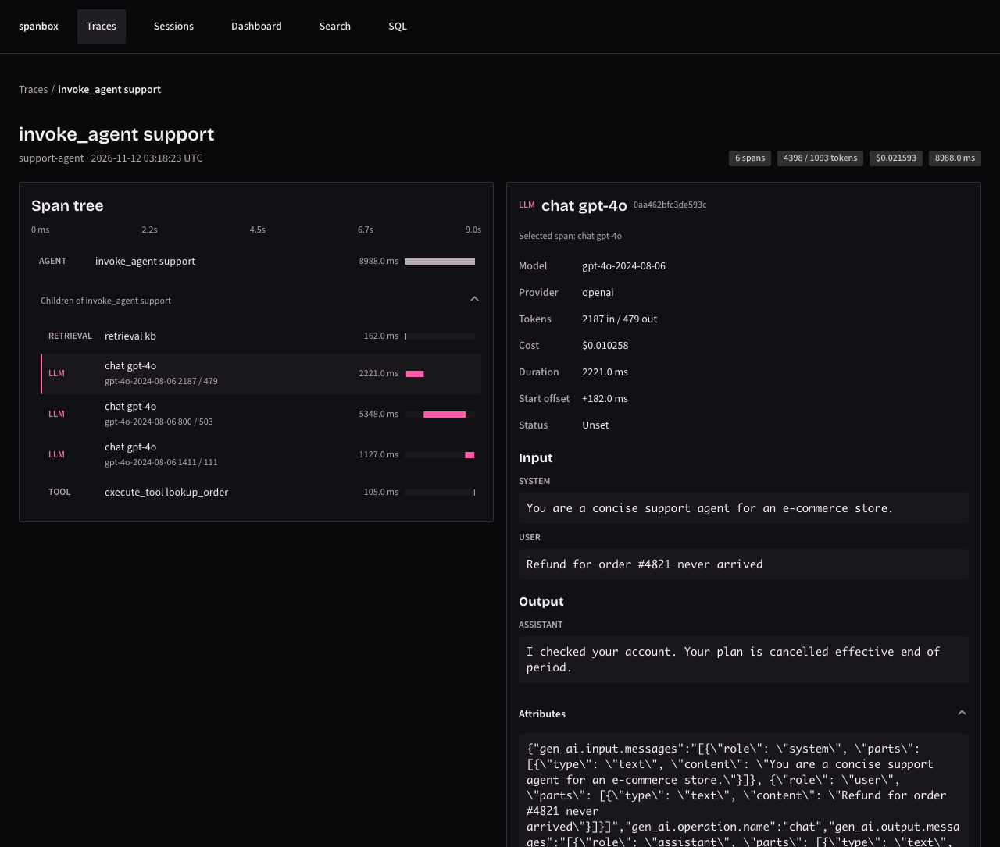
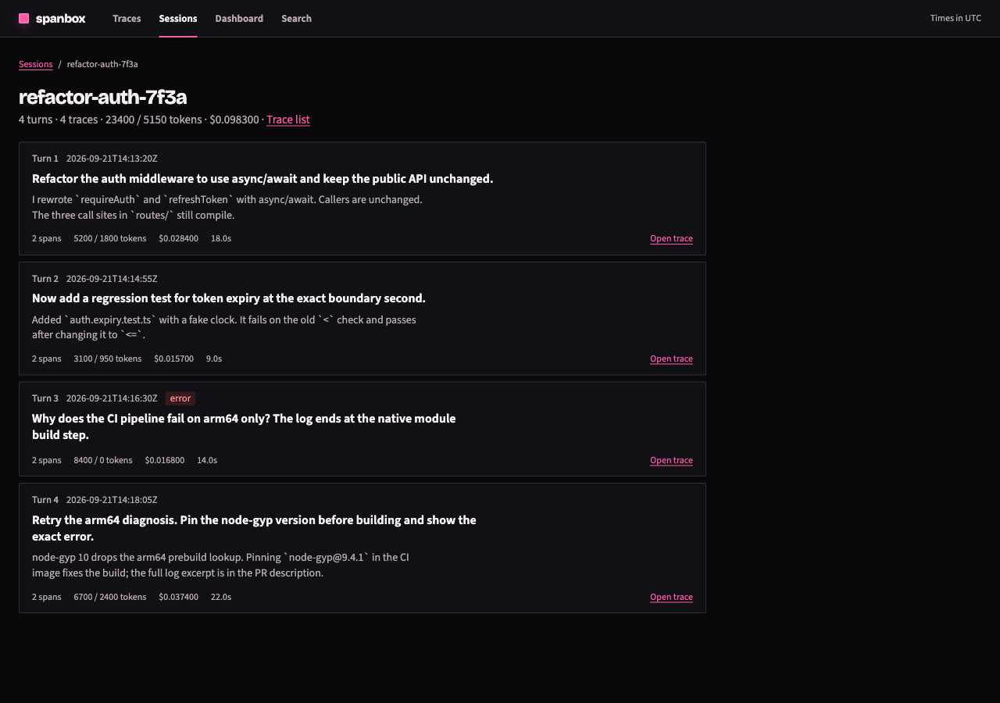
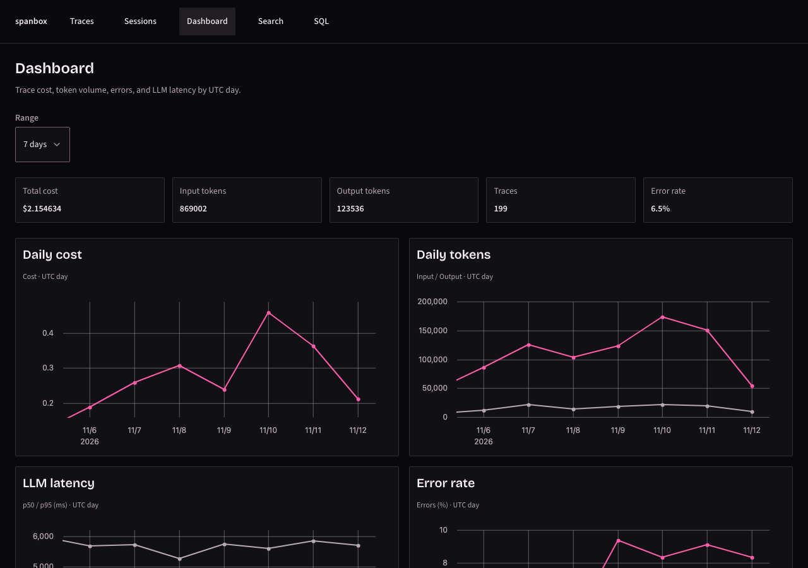

# Use the Web UI

Open `http://localhost:<PORT>` (default `4318`). The Astryx UI ships in release binaries and Docker images. With `AUTH_TOKEN` set, sign in at `/login` to get a session cookie.

## Pages

Pages serve the app shell; the UI loads data from the existing `?format=json` endpoints, plus `/dashboard/data` for charts.

| Page | Route | Shows |
|---|---|---|
| Traces | `/` or `/traces` | Filtered trace table, compact/comfortable density, NDJSON export |
| Trace | `/traces/<trace_id>` | Expandable span tree, timing waterfall, tokens, cost, selected span inspector |
| Span | `/spans/<trace_id>/<span_id>` | The trace with that span selected: input, output, attributes, events, links, resource and scope |
| Sessions | `/sessions` | Conversations and totals; `/sessions?id=<session>` shows ordered turn cards with prompt, output and trace links |
| Search | `/search?q=...` | Full-text search over span input, output and name; recent or relevance order |
| Dashboard | `/dashboard` | Daily cost, tokens, latency percentiles, error rate and model totals |
| SQL | `/sql` | Read-only console and schema; see [Run SQL queries](sql-console.md) |

`/ui` remains an alias for the trace list, not a separate front end.







## Filter traces

The trace list and export share these filters. Choose values and press **Apply**; **Load more** loads the next page without losing filters.

On Traces and Sessions, custom From/To are chosen with date and time pickers in UTC (24-hour); times between the quarter-hour presets can still be typed.

| Parameter | Meaning |
|---|---|
| `range` | `15m`, `1h`, `24h`, `7d`, or `custom` with RFC3339 `from` and `to`. Omitted means all retained traces |
| `errors=1` | Only traces with an error span |
| `service` | Service name |
| `model` | Model name |
| `session` | Session ID |
| `user` | User ID |
| `min_duration` | Minimum duration in milliseconds (non-negative, finite) |

## Inspect spans

Select a span in the tree to read its input and output. Attributes, events, links, resource and scope expand independently. Long fields initially load 2000 characters; **Show more** appends another window and shows progress. See [JSON field paging](json-api.md#reading-long-span-fields).

## Dashboard



The dashboard defaults to the last 24 hours. It reads a covering index and does not load span bodies. The same numbers are available as JSON at `/dashboard/data`.

## Keyboard, mobile and theme

- Use Tab/Shift+Tab to move between controls and the skip link to reach the main content. Enter submits forms; Enter/Space activates span buttons. Range and density controls support arrow keys.
- SQL uses a real multiline textarea; Ctrl/Cmd+Enter runs the query, while Enter inserts a newline.
- On phones, navigation and filters wrap, wide tables scroll horizontally, and the span inspector stacks below the tree. Selecting a span scrolls to its inspector. `e2e-mobile` checks iPhone 13 emulation; real-device checks remain necessary.
- Light/dark colors follow the system preference, including charts and browser theme color; reduced-motion preferences are respected.

## Develop the UI

Source lives in `web-ui/`:

```sh
pnpm --dir web-ui install --frozen-lockfile && pnpm --dir web-ui build
```

The build output in `internal/web/static/ui` is committed and embedded by Go, so a plain `go build`, release binaries and the Docker image include the UI without Node. CI rebuilds it and fails when the committed output is stale.

CSP keeps `style-src 'self'`: do not use Astryx components that inject runtime styles or `CodeBlock`. Layer slide rules ship as an external stylesheet, not an injected style tag.

## Same data as JSON

Add `?format=json` to the data routes listed in [Query the JSON API](json-api.md); the trace list API is `/?format=json`.
